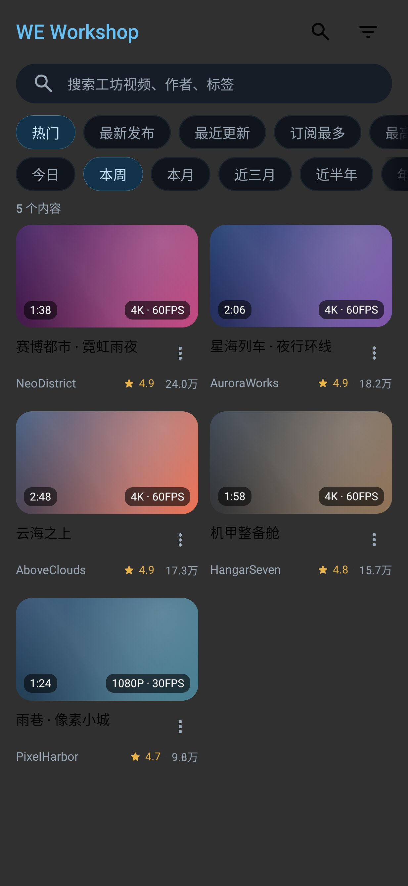
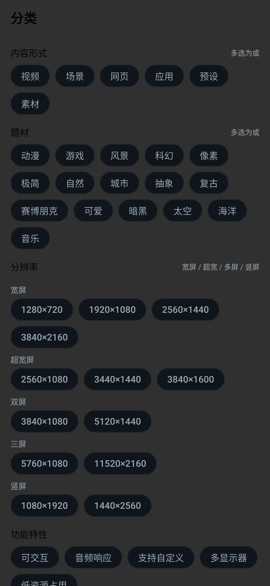
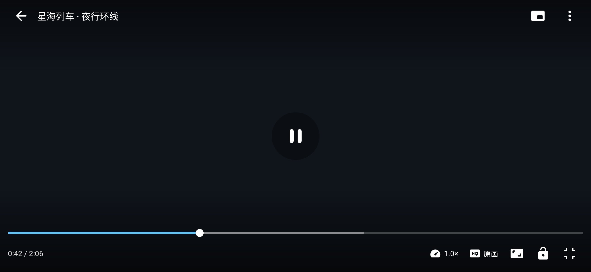
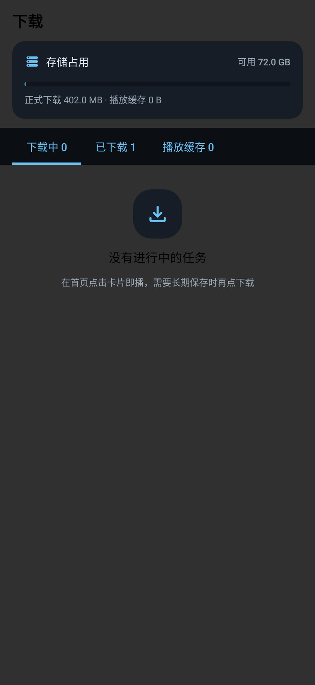
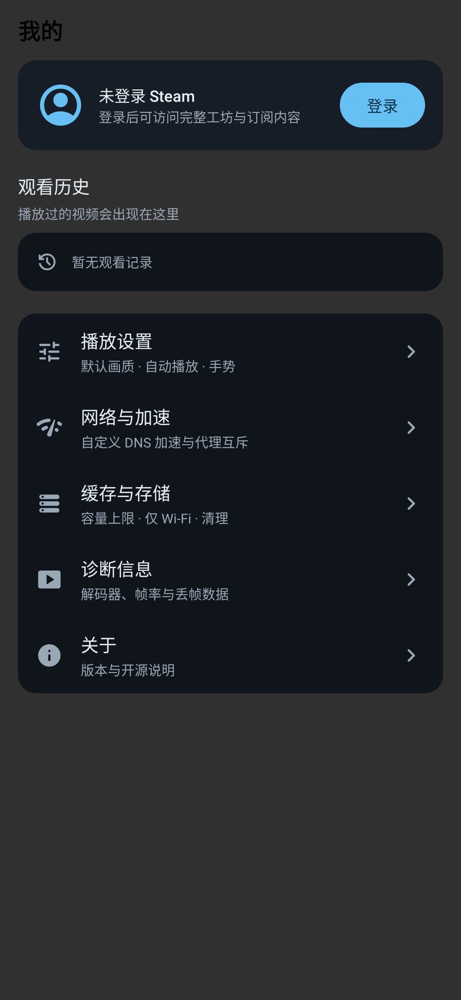
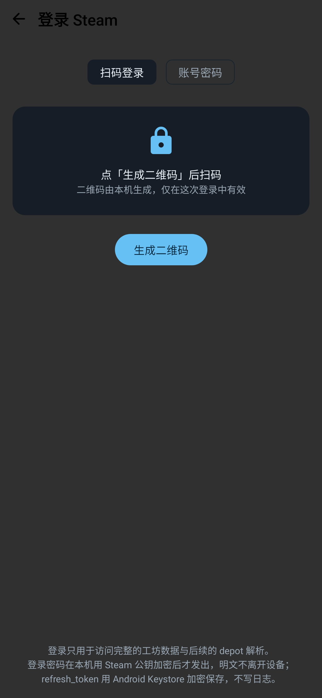

# WallpaperEngineTube

在 Android 上浏览、播放、下载 Wallpaper Engine 创意工坊的视频壁纸。

**国内网络直连可用，无需代理**；浏览、封面、播放、下载全链路均已适配，使用代理同样兼容。

## 下载

- **最新构建**：[WallpaperEngineTube-debug.apk](https://github.com/Kiastr/WallpaperEngineTube/releases/download/latest-build/WallpaperEngineTube-debug.apk)（链接固定，持续更新）
- Android 8.0 及以上，允许「安装未知来源应用」
- debug 签名可直接安装；新版覆盖安装，数据保留

## 核心体验

- **点开即播**：浏览页点卡片直接进入播放，边下边看，拖动进度即时响应
- **一次下载，两种用途**：播放中点「下载」，已缓存部分直接复用，完成后保存到系统下载目录
- **直连可用**：无需代理即可浏览工坊、加载封面、播放与下载；开代理时在设置中关闭「直连模式」即可

## 功能一览

| 模块 | 功能 |
|---|---|
| 浏览 | 热门 / 最新 / 评分 / 趋势排序与关键词搜索；题材、分辨率、特性、分级组合筛选，支持排除标签；筛选条件自动记忆 |
| 播放 | 手势亮度音量、横拖进度、长按倍速、双指缩放；横竖屏切换不中断播放；画中画小窗 |
| 下载 | 顺序队列，暂停 / 继续 / 取消 / 重试；断点续传，进程被杀也能恢复；仅 Wi-Fi 开关；保存至「下载 / WE WorkshopTube」 |
| 缓存 | 播放自动缓存，再次播放零流量；「全速缓存」退出播放页后后台下完整条视频；按配额自动清理旧缓存 |
| 账号 | Steam 扫码 / 账号密码登录，支持 Steam Guard 验证码；一次登录长期有效，凭据加密存储 |
| 其他 | 观看历史；诊断日志自助查看、复制，反馈问题可直接附上 |

## 使用说明

1. 安装后即可浏览工坊内容，无需登录
2. **播放与下载需登录拥有 Wallpaper Engine 的 Steam 账号**
3. 国内网络请在「我的 → 网络设置」开启**直连模式**
4. 遇到问题：「我的 → 诊断信息」复制日志，附在 [Issue](https://github.com/Kiastr/WallpaperEngineTube/issues) 中反馈

## 截图

| 首页 | 分类筛选 | 播放（横屏） |
|---|---|---|
|  |  |  |

| 下载管理 | 我的 | Steam 登录 |
|---|---|---|
|  |  |  |

## 声明

非官方客户端，与 Valve 无关。工坊内容版权归原作者所有；应用仅作为浏览与播放工具，不分发任何工坊内容本体。
